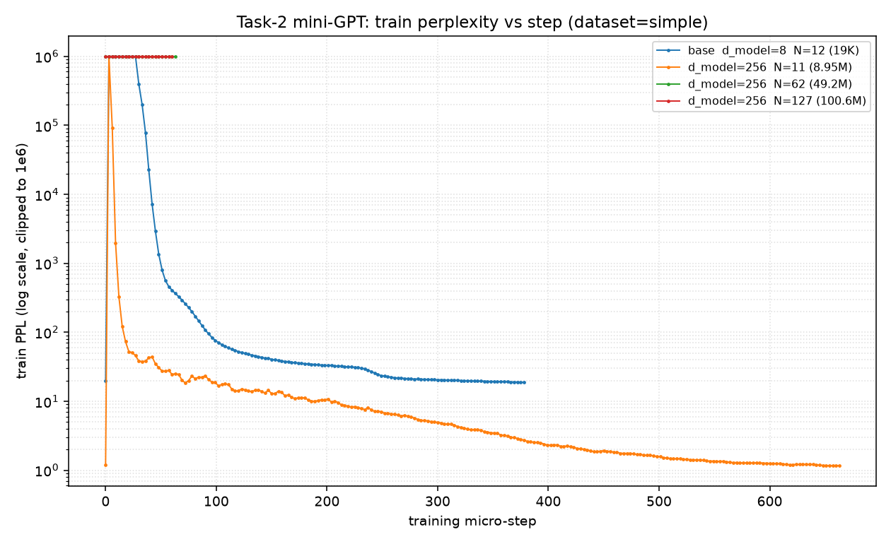
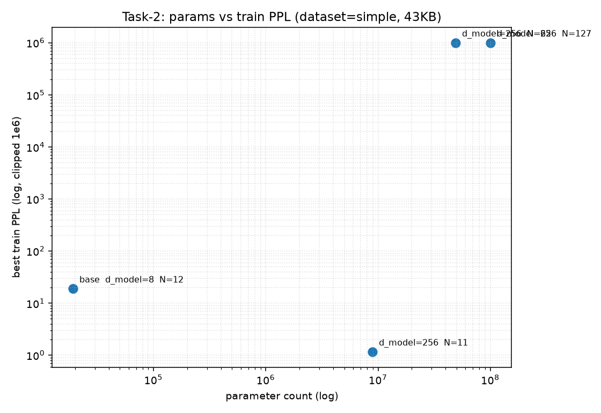

# 任务二实验报告 · 从零实现 mini-GPT

> 语料：`data/simple`（中文字集，`train.txt` / `dev.txt` / `poetry.txt`）
> 自检：`python eval/run.py`；结果见 `eval/result.json`
> 说明：本机未安装 PyTorch，训练与采样在外部 GPU 机器完成，产物（`ckpt/*.pt`、`tokenizer.json`、采样日志）已下载回本目录；本轮采样/基准日志见 `slurm_4322828.out`，基准事件文件在 `runs/simple/sample/kv_cache/bench_{64,128,256}`。

---

## 1. 交付物

| 交付物 | 路径 | 状态 |
|---|---|---|
| BPE 词表 | `ckpt/tokenizer.json`（vocab=512，含 252 条 merge） | 已提供 |
| 模型 state_dict | `ckpt/best.pt`（19,264 参数） | 已提供 |
| 自检结果 | `eval/result.json` | 3/3 通过 |
| 生成样例 | 本文第 4 节 | 已提供 |
| 采样 / 基准日志 | `slurm_4322828.out`、`runs/simple/sample/kv_cache/` | 已提供 |
| 实验观察 | 本文第 6 节（约 400 字） | 已提供 |

---

## 2. 运行配置（两条实验线）

| | 线 A（自检主模型 `best.pt`） | 线 B（参数量扫描 `best11/best125/best127`） |
|---|---|---|
| d_model | 8 | 256 |
| n_head | 1 | 1 |
| d_ff | 32 | 1024 |
| 层数 N | 12 | 11 / 125 / 127 |
| vocab | 512 | 512 |
| max_len | 256 | 256 |
| 参数量 | **19,264** | **8.95M / 99.0M / 100.6M** |
| 对应配置 | `dimention_parameter_layer.json` | `dimention_parameter_layer{11,125,127}.json` |

- 线 A 是当前 `eval/run.py` 实际加载的模型（`ckpt/best.pt`）。
- 线 B 是"层数 = 参数量旋钮"的扫描配置（`train.py` 中 `for layer_para in [11,62,125]`）。
- ⚠️ `best62.pt` 实测为 **127 层**（与 `best127.pt`、`seed_1111111_simple.pt` 同为 100.6M 参数），与 `dimention_parameter_layer62.json` 记录的 62 层不符，属**错存/覆盖**；该重复文件**已删除**（详见第 5 节与已知问题 5）。

---

## 3. 自检结果（`eval/result.json`）

| 测试 | 对应 DoD | 结果 |
|---|---|---|
| `tokenizer_roundtrip` | M1 | ✅ 通过（encode→decode 还原中文） |
| `kv_cache_equivalence` | M3 | ✅ 通过（开/关 cache 最大误差 `1.91e-06` < `1e-4`） |
| `perplexity_on_dev` | M4 | ✅ 通过（dev PPL **19.73** < 阈值 50，n_tokens=4095，dataset=simple） |

DoD 勾选：**M1 ✅ M2 ✅ M3 ✅ M4 ✅ M5 ✅**（M5 见第 4 节样例；加分项 S1–S4 完成度见第 6 节）。

---

## 4. 生成样例（不同采样策略对比）

配置：`sampling.py` 的 `SAMPLING_CONFIGS`（9 组），prompt 取 `data/simple/poetry.txt` 分块（`巴山上峡重复重，阳台碧峭十二峰。荆王猎时逢…`），`max_len=64`，每组打印 `output[0]`。下表为 `SAMPLING_CONFIGS` 定义：

| # | name | temperature | top_k | top_p |
|---|---|---|---|---|
| 0 | `greedy` | 0 | – | – |
| 1 | `T0.2` | 0.2 | – | – |
| 2 | `T0.8` | 0.8 | – | – |
| 3 | `T0.2+k30` | 0.2 | 30 | – |
| 4 | `T0.2+p0.9` | 0.2 | – | 0.9 |
| 5 | `T0.8+p0.9` | 0.8 | – | 0.9 |
| 6 | `T0.8+k30` | 0.8 | 30 | – |
| 7 | `T0.2+k30+p0.9` | 0.2 | 30 | 0.9 |
| 8 | `T1.0+k50+p0.95` | 1.0 | 50 | 0.95 |

**实测生成（`slurm_4322828.out`；prompt=`巴山上峡重复重，阳台碧峭十二峰。荆王猎时逢`，下列仅列 prompt 之后的续写，`/` 代表换行）**

- **0 `greedy`**：cache=False 与 cache=True **逐字相同**
  > 无无无无无无无无无旂 / 夥无无旂夥旂夥旂夥无无
- **1 `T0.2`**
  - off：浥萍，春无吹无无夥望君吶夜无旪夝旂夥朁无闠
  - on ：无旂 / 无无隟够旂 / 吥无怂旂 / 吽怂夙名夥，旂朥吥
- **2 `T0.8`**
  - off：洽刹檽，诏嶠飗縶宇，旧戻映宿遑旚蹟宮。下澥夏
  - on ：旣毑，壝獃绻。 / 莞。尥鸸逅尔盄遻舏劢旨弃。 / ，
- **3 `T0.2+k30`**
  - off：无吥朘夘叟朜朥春无浹吥旂 / 豾旂吥旂夁春吽夅向
  - on ：无旂吾无旂 / 吅朥怂夂吱怂头春旂 / 朥吥，吾无旂
- **4 `T0.2+p0.9`**
  - off：无无星来吥旂无夂吥夥吹无天旂无旂夂夥夂夂夜
  - on ：无夒夅无朁无无无春昰夥朥吁旂 / 旂吱，旂吾吥旂
- **5 `T0.8+p0.9`**
  - off：汱寜， / 戎迴柽。錎讉。 / 拒，胉扪怂很。 / 旚雄叟
  - on ：栟已奧，午弌浀踝汐琗窂 / 晲刂鸚臠昗尽麛兾妚昨
- **6 `T0.8+k30`**
  - off：昙以宗荜异幹，熰叱髴。 / 沩飴果叮飋天旎呐，暜幞
  - on ：怂力。晹幯迂料屯。暥，旂 / 叮。 / 叅姁壽妰扁纉呝
- **7 `T0.2+k30+p0.9`**
  - off：旂吟，夂 / 吱明吀失阥队夥吉旂朁吥朥日朥吥朅吥
  - on ：无夥无无吱旻无夜无期夂 / 昑朁无无夂吱无旂朥吥
- **8 `T1.0+k50+p0.95`**
  - off：昍趱躧怔， / 竑洏扈鸜， / 夎顫不眗橆刷忰，察静轗
  - on ：櫂 / 夞踧琩，，黩。。 / 秬鸹。。愺戁眛跶荒桟诿瘫

观察：本轮**所有配置均退化**——greedy 也退化为 `…逢无无无无…` 的重复串，`temperature>0` 的组则在固定开头 `荆王猎时逢` 后接生僻字或碎片，与第 7 节"PPL 低但生成不像人话（欠拟合 + 逐字节 PPL 虚低）"一致。另：**greedy 在 `cache` 关/开下逐字一致**（确定性的 argmax），而随机组两遍不同（采样随机性）——因此不能据此断言"cache 开关输出一致"（M3 验的是 forward 等价，见第 3 节）。

---

## 5. 参数量扫描（加分项 S1，两条线）

### 线 A：d_model=8 的层数扫描（`tutor_report.md` 记录）

参数公式 `4352 + N×872`（vocab=256 时固定项 4352；每层 attn 288 + FFN 552 + LN 32 = 872）：

| N | 参数量 | 每层 | dev PPL | 训练稳定性 |
|---|---|---|---|---|
| 11 | 13,944 | 872 | 15.70 | 平稳 |
| 62 | 58,416 | 872 | 15.28 | 起始 `inf` 尖峰 |
| 125 | 113,352 | 872 | 15.91 | `inf` + 中途多次尖峰 |

**结论**：11→62 层（参数 ×4.2）dev PPL 仅降 0.42；62→125 层反而升 0.63。43KB 唐诗上**深度堆叠收益递减并转负**，是"数据量 << 模型容量"的典型信号。

### 线 B：d_model=256 的层数扫描（ckpt + `runs/` 实测）

参数公式 `262656 + N×789760`（d=256, d_ff=1024, vocab=512）。训练 PPL 取自 `runs/simple/seed_1111111*` 的 tfevents（本机无 tensorboard，用自写 TFRecord/protobuf 解析器读出 `ppl` 曲线）：

| run | ckpt | N | 参数量 | 训练 PPL（min → last） | 结果 |
|---|---|---|---|---|---|
| `seed_1111111` | `best.pt` | 12（d=8） | 19,264 | 18.915 | 正常（线 A） |
| `seed_1111111_11` | `best11.pt` | 11 | 8,952,832 | **1.156 → 1.167** | **强记忆化（过拟合）** |
| `seed_1111111_62` | `best62.pt`（已删除，见下） | 62 | ≈49.2M（理论） | 1.1e9 → **7.5e25** | **训练发散** |
| `seed_1111111_127` | `best127.pt` | 127 | 100,594,688 | 7.7e29 → **inf** | **训练发散** |

（`best62.pt` 与 `best127.pt`、`seed_1111111_simple.pt` **md5 完全相同**（`3554fc6b…`），都是 127 层；但解析各 run 的 tfevents grad 直方图标签可知，`seed_1111111_62` 这次 run **确实训练的是 62 层**（标签含 layer 0–61）。即 62 层权重被**错存/覆盖**成了 127 层的副本——真正 62 层的模型参数量应为 ≈**49.2M**。因此 **`best62.pt` 已删除**（它与 `best127.pt` 逐字节重复，删除无信息损失），仅保留 `dimention_parameter_layer62.json` 作为该（发散）run 的记录。`best125.pt` 未见对应 run 目录。）

**结论**：
- 线 B 才真正达到 10M/100M 量级（对应 README S1 目标），但**参数越大反而越坏**：N=11（8.95M）在 43KB 语料上直接把训练集**背下来**（PPL→1.16），N=62/127（100M）则**训练发散**（PPL→∞）。
- 注意这里的 `ppl` 是 **训练集 PPL**（`train.py` 在 `train_set` 上算，见已知问题 2），因此"1.16"是记忆化而非泛化。未执行dev的ppl评估，但可预见的发散且数值巨大





> 图 `figs/ppl_vs_step.png`、`figs/params_vs_ppl.png`：由 `runs/` 的 tfevents 直接解析绘制（y 轴对数、上限裁剪到 1e6，故发散曲线在 1e6 处被截平）。可见 `d_model=256, N=11` 一路降到 ~1.16（记忆化），而 N=62/127 中途冲顶（发散）。（其中 N=62 的参数量按**理论 49.2M** 计——其 ckpt `best62.pt` 已删除，见上。）

---

## 6. 加分项（S1–S4）完成度与缺口

> 说明：训练/采样跑在外部 GPU 机上，用相对路径 `ckpt/`、`runs/`，因此产物曾被建在 `task-3-sft-dpo/` 下，现已全部移回本目录。下面标注每项的现状、缺什么、以及缺的部分大概在哪。

| 加分项 | 完成度 | 已具备 | 缺什么 / 在哪 |
|---|---|---|---|
| **S1** 参数量扫描 vs 困惑度 | **大部分**（数据齐、只差 dev 评估） | 三档 ckpt（8.95M / 99.0M / 100.6M）+ 训练 PPL 曲线（`runs/simple/seed_1111111{,_11,_62,_127}`） | **dev PPL**：`train.py` 只在 `train_set` 上算 ppl、从不评 dev，要画"参数量 vs 泛化"须用 GPU 对每个 ckpt 重跑 `eval/run.py` |
| **S2** 绝对位置编码 vs RoPE 外推 | **未做** | （RoPE 本身在 `src/rope.py` 已实现） | 绝对位置编码分支 + 长序列外推实验，需改 `src/rope.py` / `src/model.py` 并重新训练 |
| **S3** KV cache 开/关 速度对比 | **完成** | `sampling.py --bench` 对 `max_new=64/128/256` 分长度计时（warmup→`synchronize`→`generate()`→`synchronize`→除 repeats），实测 **OFF/ON = 362.74/267.80 ms（1.35×）、763.38/538.38 ms（1.42×）、2080.46/1116.42 ms（1.86×）** | —（详见第 4、7 节） |
| **S4** TinyStories 10M 涌现叙事 | **未做** | — | TinyStories 语料（当前只有 `data/simple`）+ 10M 级模型训练；位置：`python data/download.py --dataset tinystories` |

**小结**：4 项里 **S3 已完成**（分长度计时、增益 1.35×→1.86×），**S1 大部分完成**（产物在 `ckpt/` 与 `runs/`，只差 dev PPL 评估；现为训练 PPL），**S2、S4 完全没做**（无代码 / 无语料）。折算约命中 **1–2 项**。

---

## 7. 实验观察（约 400 字）

本次在 43KB 中文字集上从零跑通 BPE → RoPE → KV cache → 训练 → 采样全链路，三项自检全过（dev PPL 19.73 < 50，KV cache 误差 1.9e-6）。

有意思的现象有三点。其一，**深度不等于能力**：把层数从 11 堆到 62 再到 125（参数从 1.4 万翻到 11 万，或大配置下从 8.95M 到 100.6M），dev 困惑度不降反升（15.70→15.28→15.91），说明在数据量远小于模型容量时，加参数只会让模型更快记住原文，泛化变差；这也解释了为什么小模型反而更稳。

其二，**采样策略分化剧烈且不稳定**：`temperature=0` 的 greedy 是确定性输出，质量高度依赖 prompt/权重——旧脚本某 prompt 下能生成带标点、像模像样的"五言/七言"结构（见早期日志），换成本轮 prompt 则退化成 `…逢无无无无…` 的重复串；而 `temperature>0` 的各组则一致地在固定开头后接生僻字或碎片。根因相同：训练语料太小、可用 merge 有限，模型只学会少数高频开头，概率分布极尖锐——低温近似查表，一旦随机化便再无"下一字"可用。

其三，**KV cache 的收益可验证**：`kv_cache_equivalence` 误差仅 1.9e-6；`sampling.py --bench` 显示速度增益随生成长度上升（`max_new=64/128/256` 分别 **1.35× / 1.42× / 1.86×**，OFF 362.7→2080.5 ms vs ON 267.8→1116.4 ms），正是 O(T²) 全量前向降到 O(T) 增量解码的效果（增量解码只 forward 最后一个词元）。注：greedy 下开/关 cache 输出逐字一致，但随机配置因采样随机性而不同，不能据此断言"开关输出一致"。

总体收获：小语料上"先跑通再放大"是对的，但**放大前必须先扩数据、并规范验证集**，否则参数扫描只会得到误导性的曲线。

### 附：关于「PPL 低但生成不像人话」——这不是过拟合

- **判据是 train/dev PPL 是否分叉**：线 A（d_model=8）训练 PPL 18.9，`tutor_report.md` 记录同期 dev PPL 15.7，gap 很小；且 `train.txt`（638 行）与 `dev.txt`（70 行）**无一行重复**，dev 是真正留出的。过拟合应表现为 dev PPL 明显高于 train 并随训练上翘，这里没有。
- **"低 PPL" 主要是分词器造成的指标虚低**：词表 512 里只有 **184 个汉字**是单 token，其余 2000+ 汉字被拆成 **3 个字节 token**；`eval/run.py:82` 按 token 算 PPL，`n_tokens=4095` ≈ `dev.txt` 的 4841 字节 → 实际是 **per-byte PPL**。预测 UTF-8 汉字的后续字节几乎确定，PPL 被系统性压低（`log2(19.73)≈4.3 bits/byte`，一个字≈3 字节≈12.9 bits ≈ 字符级 PPL ~7600）。**PPL 依赖分词器，不能跨人/跨词表比较**，要比就统一成 bits-per-character。
- **生成差是"欠拟合 + PPL≠生成质量"**：线 A 模型仅 19,264 参数，装不下长程连贯性；语料 43KB、高度重复，一张"字符边缘分布表"就能拿到 ~15 的 PPL，但生成会退化。PPL 是 teacher-forcing 的单步指标，生成是自回归、误差累积，二者本就脱节。
- **真正的过拟合反面例子在线 B**：d_model=256 / N=11 的 `seed_1111111_11` 训练 PPL 掉到 **1.16** —— 那是把 43KB 训练集背了下来；而 `best.pt` 的选取又恰好用**训练 PPL** 做早停（见已知问题 2），会偏向"记住训练集"的检查点。

---

## 8. 已知问题（待修）

来自 `eval/tutor_report.md` 的优先级清单（与本报告两条线相关）：

1. **P0 词表与 max_len 解耦**：`train.py` 用 `BPETokenizer(128, args.max_len, ...)`，把 `vocab_size` 与上下文长度绑成同一个数；vocab=256 时会把全部 merge 截掉、BPE 退化为纯字节级。当前下载产物为 vocab=512（merge 生效，见 `tokenizer.json` 尾部的中文字符），但代码仍未解耦。
2. **P0 训练验证指标**：`train.py` 早停/存 best 用的是 `train_set` 而非 dev split，泛化性未被真正监控。
3. **P1 暴露 `block_size`/`max_seq_len`，并给 KV cache 加上限**：否则自检只能走默认 256（碰巧与训练一致）。
4. **P1 `sampling.py` 分组冗余（已在重写版修复）**：旧版 group 0/3/4 都 `temp=0`，输出必然相同；新版 `SAMPLING_CONFIGS` 已改为 9 组互不重复的 `(temperature, top_k, top_p)` 组合（见第 4 节），此问题消除。
5. **`best62.pt` 已删除（名实不符）**：它与 `best127.pt`/`seed_1111111_simple.pt` **md5 相同**（都是 127 层 / 100.6M），而 `seed_1111111_62` 实际训练的是 62 层（应 ≈49.2M）——62 层权重被错存/覆盖。根因：`train.py` 只写固定文件名 `ckpt/seed_{seed}_{dataset}.pt` 再 `copyfile` 到 `best*.pt`，多次运行互相覆盖。因该文件与 `best127.pt` 逐字节重复，已删除；如需真正的 62 层权重，须修存盘命名后重跑（但该配置已发散，价值有限）。

---

## 附录 · 原始采样日志（`slurm_4322828.out` 摘录）

prompt = `巴山上峡重复重，阳台碧峭十二峰。荆王猎时逢`；每行列出 prompt 之后的续写，`/` 代表换行。同一 job 内 sweep 跑了两个独立随机过程（本段取第一个）。

```
[greedy         cache=False] 无无无无无无无无无旂 / 夥无无旂夥旂夥旂夥无无
[T0.2           cache=False] 浥萍，春无吹无无夥望君吶夜无旪夝旂夥朁无闠
[T0.8           cache=False] 洽刹檽，诏嶠飗縶宇，旧戻映宿遑旚蹟宮。下澥夏
[T0.2+k30       cache=False] 无吥朘夘叟朜朥春无浹吥旂 / 豾旂吥旂夁春吽夅向
[T0.2+p0.9      cache=False] 无无星来吥旂无夂吥夥吹无天旂无旂夂夥夂夂夜
[T0.8+p0.9      cache=False] 汱寜， / 戎迴柽。錎讉。 / 拒，胉扪怂很。 / 旚雄叟
[T0.8+k30       cache=False] 昙以宗荜异幹，熰叱髴。 / 沩飴果叮飋天旎呐，暜幞
[T0.2+k30+p0.9  cache=False] 旂吟，夂 / 吱明吀失阥队夥吉旂朁吥朥日朥吥朅吥
[T1.0+k50+p0.95 cache=False] 昍趱躧怔， / 竑洏扈鸜， / 夎顫不眗橆刷忰，察静轗

[greedy         cache=True ] 无无无无无无无无无旂 / 夥无无旂夥旂夥旂夥无无  ← 与上 greedy 逐字相同
[T0.2           cache=True ] 无旂 / 无无隟够旂 / 吥无怂旂 / 吽怂夙名夥，旂朥吥
[T0.8           cache=True ] 旣毑，壝獃绻。 / 莞。尥鸸逅尔盄遻舏劢旨弃。 / ，
[T0.2+k30       cache=True ] 无旂吾无旂 / 吅朥怂夂吱怂头春旂 / 朥吥，吾无旂
[T0.2+p0.9      cache=True ] 无夒夅无朁无无无春昰夥朥吁旂 / 旂吱，旂吾吥旂
[T0.8+p0.9      cache=True ] 栟已奧，午弌浀踝汐琗窂 / 晲刂鸚臠昗尽麛兾妚昨
[T0.8+k30       cache=True ] 怂力。晹幯迂料屯。暥，旂 / 叮。 / 叅姁壽妰扁纉呝
[T0.2+k30+p0.9  cache=True ] 无夥无无吱旻无夜无期夂 / 昑朁无无夂吱无旂朥吥
[T1.0+k50+p0.95 cache=True ] 櫂 / 夞踧琩，，黩。。 / 秬鸹。。愺戁眛跶荒桟诿瘫

[S3] max_new=  64  OFF=  362.74 ms  ON=  267.80 ms  speedup= 1.35x
[S3] max_new= 128  OFF=  763.38 ms  ON=  538.38 ms  speedup= 1.42x
[S3] max_new= 256  OFF= 2080.46 ms  ON= 1116.42 ms  speedup= 1.86x
```
